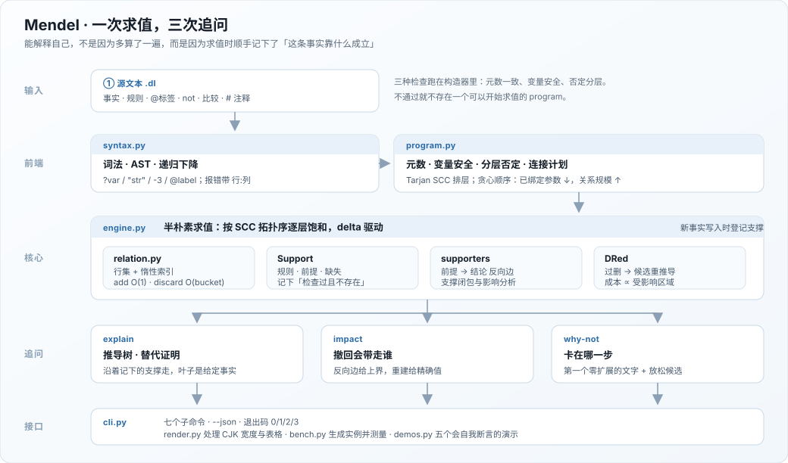

# Mendel

**一个会解释自己的 Datalog 引擎。** 每个派生事实都带一棵推导树；每条被撤回的事实都能算出谁会跟着消失；每一个「查不到」都能说明卡在哪一步。纯 Python 标准库，零第三方依赖。

[](https://github.com/18971181532/mendel/actions/workflows/tests.yml)




## 项目简介

Datalog 是 SQL 的递归子集：只允许 `p(?x, ?y) :- q(?x, ?z), r(?z, ?y).` 这种形式的规则，没有函数符号，因此 Herbrand 域有限、求值一定终止、结果唯一。它足够表达传递闭包、访问控制、依赖分析、程序点分析，也足够小，可以在一晚上读完整个实现。

已有的 Datalog 实现大多只回答「这个事实成不成立」。Mendel 把另外三个问题当成一等公民：

| 问题 | 命令 | 靠什么回答 |
| --- | --- | --- |
| 它为什么成立？ | `mendel explain` | 求值时记下的 `Support`（规则 + 前提 + 被检查为不存在的否定目标） |
| 删掉这条会怎样？ | `mendel impact` / `--remove` | 支撑图的反向边 + DRed 重推导 |
| 它为什么不存在？ | `mendel why-not` | 从规则反向走，找到第一个零匹配的文字，并展示「放松一个参数」后的近邻 |

一句话：**不是「能算闭包」，而是「算完之后还能被追问」。**

## 功能

- **语言**：事实、规则、分层否定、比较（`= != < <= > >=`）、赋值形式的 `=`、规则标签、`#`/`%` 注释
- **静态检查**：元数一致、变量安全（每个变量必须先被正向目标绑定）、否定分层（拒绝 `p :- not p` 这类无最小模型的程序），错误带文件名与行号
- **求值**：半朴素迭代、按 SCC 分层、双参数索引、贪心连接顺序（`mendel plan` 可查看每一步的绑定数与关系规模）
- **溯源**：推导树、替代证明枚举（`explain --all`）、否定目标的「absent」记录、有界深度的反向搜索
- **增量**：`add_fact` 半朴素传播；`remove_fact` 用 DRed（过删 + 候选重推导）；`impact` 提供记录支撑上界与精确重建两种答案
- **接口**：7 个子命令、JSON 输出、四个不混淆的退出码（0 有答案 / 1 文件读不到 / 2 程序有错 / 3 答案是否定）
- **配套**：5 个实例生成器、3 套基准（quick / core / deep）、5 个会自我断言的小演示、151 个测试
- **零依赖**：`pip install` 不需要任何东西，`python run.py` 直接可用

## 环境与依赖

- Python **3.10+**（使用了 `X | Y` 类型标注与 `dataclasses`）
- 只用标准库：`argparse`、`dataclasses`、`difflib`、`json`、`random`、`re`、`unicodedata`、`unittest`
- Windows / macOS / Linux 均可；Windows 控制台会自动切到 UTF-8，渲染层对 CJK 宽度做了两格处理

## 安装与运行

不需要安装也能跑：

```bash
git clone https://github.com/18971181532/mendel.git
cd mendel

python run.py --version        # mendel 1.0.0
python run.py demo             # 列出五个演示
python run_tests.py            # 151 tests, 约 2 秒
```

作为包安装后获得 `mendel` 命令：

```bash
pip install -e .
mendel --version
```

## 使用示例

示例程序在 `examples/data/`：`family.dl` 是一棵五代家谱，`policy.dl` 是带否定的访问控制，`diamond.dl` 是一张有两条路径的菱形图（用来演示「同一个事实的两个证明」）。

### 1. 求解与查询

```console
$ python run.py run examples/data/family.dl --stats
program   family.dl
strata    3
facts     16 (5 given, 11 derived)
rounds    7
firings   11
time      220 µs

predicate  arity  facts  given
─────────  ─────  ─────  ─────
ancestor       2      9
parent         2      5  yes
sibling        2      2

$ python run.py run examples/data/family.dl --goal 'ancestor("ada", ?y)'
ancestor("ada", ?y)   5 answers
  ancestor("ada", "bob")
  ancestor("ada", "cy")
  ancestor("ada", "dee")
  ancestor("ada", "eve")
  ancestor("ada", "fay")
```

`--goal` 没有答案时退出码是 **3**，可以直接进 shell 脚本。

### 2. 解释一个事实

```console
$ python run.py explain examples/data/family.dl 'ancestor("ada", "fay")'
ancestor("ada", "fay")   [@step]
├─ parent("ada", "bob")   (given)
└─ [@step] ancestor("bob", "fay")
   ├─ parent("bob", "dee")   (given)
   └─ [@ancestor#1] ancestor("dee", "fay")
      └─ parent("dee", "fay")   (given)
```

每条边标出用了哪条规则，叶子标 `(given)`。否定推出的结论会多出一行 `not p(...)   (absent)`——这是求值时**检查过且确实不存在**的目标，不是省略：

```console
$ python run.py explain examples/data/policy.dl 'denied("bob", "prod")'
denied("bob", "prod")   [@deny]
├─ user("bob")   (given)
├─ resource("prod")   (given)
└─ not can("bob", "prod")   (absent)
```

树是从记录下来的支撑走出来的，所以只保证「有一条这样的证明」；要问「还有没有别的证明」，用 `--all`，它做有界反向搜索：

```console
$ python run.py explain examples/data/diamond.dl 'ancestor("ada", "dee")' --all
derivation 1 of 2
ancestor("ada", "dee")   [@step]
├─ parent("ada", "cy")   (given)
└─ [@ancestor#1] ancestor("cy", "dee")
   └─ parent("cy", "dee")   (given)

derivation 2 of 2
ancestor("ada", "dee")   [@step]
├─ parent("ada", "bob")   (given)
└─ [@ancestor#1] ancestor("bob", "dee")
   └─ parent("bob", "dee")   (given)
```

`diamond.dl` 里 `dee` 有两条上行路径，所以它有两个证明；`family.dl` 是链状的，同一个查询只会返回一条。

### 3. 为什么这个事实不存在

```console
$ python run.py why-not examples/data/family.dl 'ancestor("fay", "ada")'
no fact matches ancestor("fay", "ada").

closest attempt: @ancestor#1
  ancestor(?x, ?y) :- parent(?x, ?y).
  matched 0 of 1 goals before getting stuck.
  ancestor/2 holds 9 facts, none of them the goal.
  stuck at: parent("fay", "ada")
```

它会把所有规则按「走得多远」排序，报告最先卡住的文字，并把**已经绑定后的**形式显示出来（`parent("fay", "ada")`，而不是 `parent(?x, ?y)`）。

如果卡住的是一个正向目标，而且它已经有列被绑定，引擎会逐个放松这些列，数一数还剩多少候选——这就是「差在哪」的证据：

```console
$ python run.py why-not examples/data/diamond.dl 'ancestor("ada", "zzz")'
no fact matches ancestor("ada", "zzz").

closest attempt: @step
  ancestor(?x, ?z) :- parent(?x, ?y), ancestor(?y, ?z).
  matched 1 of 2 goals before getting stuck.
  ancestor/2 holds 9 facts, none of them the goal.
  stuck at: ancestor("bob", "zzz")
  relaxing argument 2 leaves 2 candidates:
    ancestor("bob", "dee")
    ancestor("bob", "fay")
```

如果卡住的是一句比较，就没有「放松」可言了，它只会告诉你比较对已找到的每个匹配都失败：

```console
$ python run.py why-not examples/data/policy.dl 'can("cy", "prod")'
no fact matches can("cy", "prod").

closest attempt: @can#3
  can(?u, ?r) :- role(?u, "viewer"), resource(?r), ?r = "archive".
  matched 1 of 2 goals before getting stuck.
  can/2 holds 7 facts, none of them the goal.
  stuck at: "prod" = "archive"
  the comparison fails for every match found so far
```

注意 `matched 1 of 2`：因为 `?r` 已经从查询里绑成了 `"prod"`，`?r = "archive"` 不再起赋值作用，退化成一句纯过滤器，而过滤器的「规模」是 0，于是计划把它排到 `resource(?r)` 之前——能早一点短路就早一点。所以它走完 `role(?u, "viewer")` 这一条目标就撞上了比较。「满足的目标数」只数正向目标，不数比较。

### 4. 撤回一条事实

```console
$ python run.py impact examples/data/family.dl 'parent("bob", "dee")' --exact
retracting parent("bob", "dee") would remove 4 facts (exact)

predicate  facts
─────────  ─────
ancestor       4
```

`--exact` 会真的重建一次再比对；不加这个参数则走记录支撑，速度快，但只是上界。两种答案不一样的时候，它会告诉你差在哪：

```console
$ python run.py impact examples/data/diamond.dl 'parent("ada", "cy")' --exact
retracting parent("ada", "cy") would remove 1 fact (exact)
  recorded supports predicted 2; 1 survive through alternative derivations
```

`ancestor("ada", "dee")` 的记录支撑走的是 `ada → cy → dee`，看起来要跟着消失；但 `ada → bob → dee` 这条路还在，重推导之后它又回来了。上界不是谎报，它只是诚实地承认「我只知道这一条证明」。

实际撤回：

```console
$ python run.py run examples/data/family.dl --remove 'parent("bob", "dee")'
...
- parent("bob", "dee")  ->  5 facts removed
```

`5` 是被撤回的那条加上跟着一起消失的 4 条 `ancestor`。这里不拿 `remove_fact` 的返回值凑数，而是量「操作前后事实总数之差」——加事实时同理（`--add 'parent("fay", "gus")'` 会报 `5 facts added`：一条给定，四条派生）。

### 5. 查看求值计划

```console
$ python run.py plan examples/data/family.dl
stratum 0   parent/2

stratum 1   ancestor/2
  @ancestor#1  ancestor(?x, ?y) :- parent(?x, ?y).
    1. parent(?x, ?y)                     0 bound, 5 rows
  @step  ancestor(?x, ?z) :- parent(?x, ?y), ancestor(?y, ?z).
    1. parent(?x, ?y)                     0 bound, 5 rows
    2. ancestor(?y, ?z)                   1 bound, 9 rows

stratum 2   sibling/2
  @sibling#1  sibling(?x, ?y) :- parent(?p, ?x), parent(?p, ?y), ?x != ?y.
    1. parent(?p, ?x)                     0 bound, 5 rows
    2. parent(?p, ?y)                     1 bound, 5 rows
    3. ?x != ?y                           filter
```

每一步显示已经绑定的参数个数和当前关系规模，连接顺序就是按这两个数贪心选出来的：先按已绑定参数**降序**（绑定越多，候选越少），再按关系规模**升序**。比较不占关系，规模记作 0，所以它总是尽可能往前排——`?x != ?y` 在没有绑定任何变量时只能排在最后，等两个 `parent` 都连完；而在 `why-not` 里 `?r` 已经从查询里绑定了，同一句比较就会插到中间去尽早短路。它不是代价模型，只是一份可以拿来争论的计划。

### 6. 基准

```console
$ python run.py bench core
instance       given   facts  derived  rounds  firings      time
─────────────  ─────  ──────  ───────  ──────  ───────  ────────
chain-200        199  20,099   19,900     201   19,900  127.7 ms
grid-12x12       528  21,264   20,736      24   76,560  295.7 ms
random-80-240    240   6,169    5,929      11   18,258   69.3 ms
policy            92     572      480       7      480    4.3 ms

4 instances, 48,104 facts, 115,198 firings, 497.0 ms total
```

## 语言与语义

| 构造 | 写法 | 说明 |
| --- | --- | --- |
| 事实 | `parent("ada", "bob").` | 必须是基项（ground） |
| 规则 | `ancestor(?x, ?z) :- parent(?x, ?y), ancestor(?y, ?z).` | `?name` 是变量，裸标识符是谓词名 |
| 标签 | `@step ancestor(...) :- ...` | 出现在 `explain`/`plan` 里，不写则自动生成 `pred#n` |
| 否定 | `not blocked(?x)` | 变量必须已被正向目标绑定 |
| 比较 | `?x != ?y`、`?x < 3` | 两侧都必须已绑定 |
| 赋值 | `?y = ?x`、`?y = "fixed"` | 一侧是未绑定变量时起赋值作用 |
| 常量 | `"text"`、`-3` | 字符串支持 `\" \\ \n \t` 转义 |

三条静态规则：

1. **有限域**：没有函数符号，常量只来自程序文本，所以 Herbrand 域有限。
2. **安全**：头、否定、比较里的每个变量，都必须先被某个正向目标（或 `=` 赋值）绑定。不安全就拒绝加载。
3. **分层否定**：谓词依赖图的强连通分量里不允许出现否定边。否则没有唯一最小模型，求值可能震荡；`Program` 构造时直接报错并打印回路。

## 工作原理

**求值。** 按 SCC 的拓扑序逐层饱和。同一层内用半朴素迭代：每一轮至少有一个子句体文字被限制在上一轮新产生的 `delta` 里，避免重复连接。新事实写入关系后立即登记 `Support(rule, premises, absences)`，并给每条前提加一条反向边 `supporters[premise] -> fact`。这两张表就是后面所有解释能力的来源。

**增量新增。** 把新事实作为 `delta`，从它所在的层开始向上饱和。这里有一个容易漏掉的点：一个低层事实必须能驱动**上层**那些同时引用低层与递归谓词的规则。最初的实现只把「本层 delta」当驱动源，于是新增 `parent("fay","gus")` 时只得到 `fay->gus`，丢掉了 `ada->gus`。现在每轮把「本层变化 + 下层变化」合并成 driver，下层 delta 只用一轮（它已经被完整关系连接过了）。

**增量删除（DRed）。** 先沿 `supporters` 做过删：所有（记录的）支撑用到这条事实的结论都摘掉。然后只对这批候选做重推导：逐条尝试用当前数据库重新证明，成功就带着新支撑放回；某条候选需要另一条候选时，靠外层循环再来一遍。成本正比于**受影响区域**，不是数据库大小——这一点在下面的数字里有一个反例。

**为什么不存在。** 从规则头反向匹配目标，按计划顺序逐文字扩展环境。第一个扩展为空的环境就是「卡住的地方」；如果它是正向目标，再逐个放松已绑定的列，数一数还剩多少候选，作为「差在哪」的证据。搜索有环境数上限（400），到达上限会如实说明，而不是假装已经穷尽。

## 目录结构

```text
mendel/
├── mendel/
│   ├── __init__.py     公开 API 与版本号（58 行）
│   ├── syntax.py       词法、AST、解析器（421 行）
│   ├── program.py      元数、安全、分层、连接顺序（372 行）
│   ├── relation.py     关系存储与增量索引（95 行）
│   ├── engine.py       半朴素求值、支撑、DRed（644 行）
│   ├── provenance.py   推导树、替代证明、why-not（425 行）
│   ├── render.py       CJK 宽度、表格、数字格式（134 行）
│   ├── bench.py        实例生成器与测量（249 行）
│   ├── demos.py        五个自检演示（195 行）
│   └── cli.py          七个子命令（561 行）
├── tests/              9 个测试文件，151 个用例（1,434 行）
├── examples/
│   ├── data/           family.dl, policy.dl, diamond.dl
│   └── *.py            三个可独立运行的示例
├── docs/architecture.svg
├── .github/workflows/tests.yml   3 平台 × 4 个 Python 版本
├── run.py              不安装直接跑 CLI
├── run_tests.py
├── run_demos.py
├── pyproject.toml
└── LICENSE
```

## 实测数字

环境：Windows 11，Python 3.13.12，单线程；一次运行的实测值（绝对值会随机器波动，比例关系稳定）。

| 测量 | 结果 |
| --- | --- |
| 引擎代码 | 3,154 行（10 个文件），测试 1,434 行，示例 146 行 |
| 测试 | **151 个用例 / 约 2 秒**，零第三方依赖 |
| `chain-200` 传递闭包 | 20,099 条事实 / 201 轮 / **128 ms** |
| `chain-300` | 45,149 条事实（其中 44,850 条路径）/ **355 ms** |
| `grid-12x12` 双向网格 | 21,264 条事实 / 76,560 次规则触发 / **296 ms** |
| `random-80-240` | 6,169 条事实 / **69 ms** |
| `policy`（40 用户 12 资源，含否定） | 572 条事实 / **4.3 ms** |
| `core` 合计 | 48,104 条事实 / 497 ms |
| 撤回叶边（200 节点链） | **14.6 ms**，重建 147.6 ms（**10.1×**） |
| 撤回中间边（同上） | **136.6 ms**，重建 68.9 ms（**0.50×**，重建更快） |

最后一行是刻意保留的：增量维护不是魔法。当一半闭包都依赖被撤回的那条边时，逐条重推导和从头算一遍没有本质区别，甚至更慢。Mendel 不把这种情况藏起来。

## 测试

`python run_tests.py` 跑 151 个用例，重点不是覆盖率，而是**与独立参照物对拍**：

- **100 个随机正程序**：引擎结果 vs 一个「枚举全域赋值、反复迭代到不动点」的朴素求值器。两者不共享任何代码。
- **24 个随机程序 × 6 次随机增删**：每一步之后，增量维护的数据库都必须与「从当前 EDB 重建」逐事实相等。
- 解析器/分层/安全的边界：变量安全、否定回路、元数冲突、重复标签、转义、零元谓词。
- 溯源：树结构、否定缺失记录、菱形图的两种证明、深度截断、why-not 的受阻位置与放松候选。
- CLI：七个命令的输出、JSON 结构、退出码 0/1/2/3、错误定位。
- 演示：每个演示打印的数字，测试会用一个全新的引擎重新算一遍来核对。

## 已知边界

- **没有聚合**（`count`/`sum`/`min`）和**没有函数符号**。这两样都会破坏「有限域 + 唯一最小模型 + 无环支撑图」这三个前提，需要另一套语义，不是加个开关就能解决的。
- **没有 magic sets / 按需求值**。`run --goal` 是先物化再过滤；大图上只查一个点仍然要付全量闭包的钱。
- **单线程、全内存**。没有磁盘溢出，也没有并行半朴素。
- **`explain` 展示一条记录下来的证明**，不保证是最短的；`explain --all` 是有界搜索（默认深度 64、8 条），找不到第二条只说明「在这个界限内没找到」，不说明唯一。
- **DRed 的成本随受影响区域增长**，大范围撤回可能不如重建（上表最后一行）。
- **`=` 的赋值语义**只在「一侧是未绑定变量、另一侧已绑定」时生效；两边都未绑定会被安全分析拒绝。

## 实现过程中抓到的 bug

都是自己写出来、被测试或基准抓到的，按发现顺序。留着比删掉有用：它们正是这套测试存在的理由。

1. **跨层 delta 丢失**：新增低层事实时，上层「低层谓词 + 递归谓词」混合的规则不会被驱动，`ada->gus` 凭空消失。半朴素循环需要把下层变化并入本轮的 driver。
2. **提升过的事实删不掉也回不来**：`add_fact` 把派生事实提升为给定事实时摘掉了它的支撑；再撤回这条断言，它不在过删集合里，于是即使规则仍能推出它也不会回来。撤回时要把被删事实本身列为重推导候选。
3. **`Fact` 与 `row` 混用**：`remove_fact` 判断「这条还在不在」时，拿整条事实 `("p", (1,))` 去和行元组 `{(1,)}` 比，永远不相等，于是把所有已经重新推导回来的事实也报成「消失」。同样的错误在 `build_tree` 里也出现过一次。
4. **基准自己的 O(n²)**：`sum(1 for f in removed if f in engine.all_facts())` 对一万条被删事实各重建一次全集，把 0.26 秒的测试拖成 74 秒。数字难看时，先怀疑测量代码。
5. **why-not 的计划没有考虑头部绑定**：把 `?r = "staging"` 当成赋值提前调度，报告「满足 1 条」而实际匹配了 2 条。
6. **`derivations` 不把给定事实当叶子**：反向搜索走到 EDB 就整支放弃，所有经过给定事实的证明都返回 0 条。

## License

MIT，见 [LICENSE](LICENSE)。
